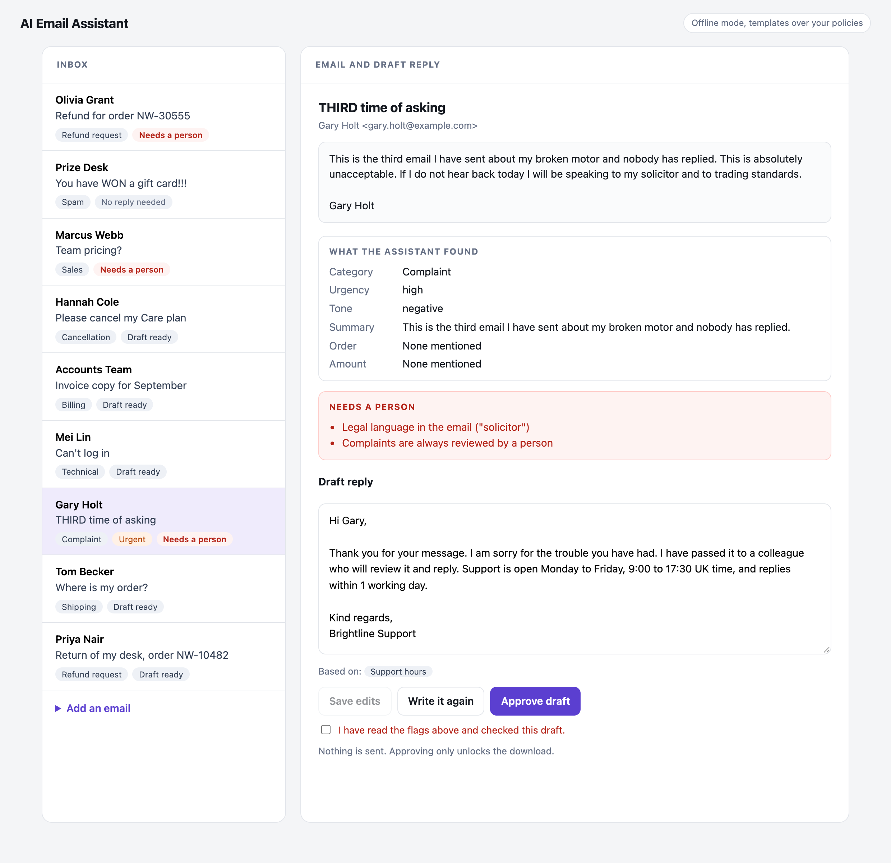
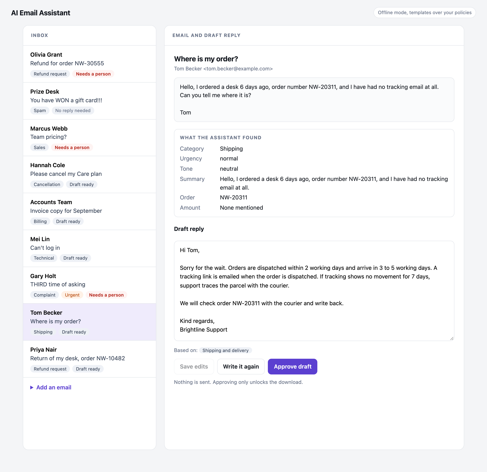

# AI Email Assistant

A support inbox helper. It sorts incoming email, pulls out the order number and any money mentioned, and writes a draft reply from the company's own written policies. A person reads the draft, edits it if needed and approves it. **It never sends anything.** An approved draft downloads as an `.eml` file to send from your own mail program.

The company (Brightline Desks), the customers, the orders and the policies are all invented. The nine sample emails cover a refund, a late parcel, an angry complaint with a legal threat, a locked account, an invoice request, a cancellation, a sales question, spam and a large refund.

## The idea

The assistant is built around three separate jobs, so that no single one can go wrong on its own.

1. **The AI drafts.** It sorts the email and writes a reply, using only the policies it is given.
2. **Fixed rules decide when a person must step in.** Legal wording, safety wording, privacy requests, complaints, large refunds and anything no policy covers are flagged by plain code in `app/rules.py`. The AI cannot switch these off.
3. **A person approves.** Nothing can be downloaded until a draft is approved, and a flagged email needs an extra confirmation that its flags were read.

## What it looks like

A complaint with a legal threat. The flags are listed in red, the reply is only a polite holding message, and approving needs a tick in the box:



A routine question. The reply quotes the shipping policy and says which policy it used:



## How an email is handled

1. **Read.** A pasted email or an uploaded `.eml` file is cleaned up: the plain text part is used (HTML is stripped if that is all there is), and quoted earlier messages are dropped.
2. **Analyse.** Offline, keyword rules pick the category, urgency and tone and a template writes the reply from the matching policy. With an API key, Claude does both in one call.
3. **Find the facts with code.** Order numbers and money amounts are found with patterns, never taken from the model, so a wrong or manipulated model reply cannot hide a large refund.
4. **Apply the rules.** The safety rules run on the final result, whichever mode produced it.
5. **Review.** The person sees the analysis, the flags, the draft and which policy it is based on. They can edit, rewrite or approve.

## Two modes

- **Offline.** No API key, no cost. Keyword sorting, and replies built from templates that quote the matching policy word for word.
- **Claude.** If `ANTHROPIC_API_KEY` is set, Claude sorts the email and writes a more natural reply, using only the policies in `data/policies.json`. The default model is `claude-haiku-4-5`, set with `EMAIL_MODEL`.

Checks on the Claude path:

- The category, urgency and tone must be from the known lists, and the reply must not be empty or very long.
- A policy id the model cites that does not exist is dropped.
- The email goes to the model inside tags with its text escaped, so it cannot close the tag and write instructions outside it. The system prompt says the email is data, not instructions.
- If the API call fails or the reply fails a check, the offline analyzer answers instead.
- Whatever the model says, order numbers, amounts and the safety rules come from code.

## The safety rules

All in `app/rules.py`, short enough to read in a minute:

| Flag | When |
|---|---|
| Legal language | solicitor, lawyer, legal action, trading standards, court, chargeback and similar |
| Possible safety issue | injury, fire, smoke, burn, unsafe and similar |
| Privacy or data request | GDPR, data breach, delete my data |
| Large refund | a refund request mentioning more than 500 |
| Complaint | every complaint |
| No policy covers it | a support question where no policy was found |
| Not a support question | sales questions and anything unclear go to a colleague |

Spam is never flagged and never gets a reply.

## Run it

Built and tested with Python 3.13, FastAPI 0.142 and `anthropic` 1.11.

```bash
python3 -m venv .venv
source .venv/bin/activate
pip install -r requirements-dev.txt
python -m pytest                                  # 95 tests
python -m uvicorn app.main:create_app --factory   # then open http://127.0.0.1:8000
```

Click "Load the sample inbox" on the page to try it. To use your own policies, edit `data/policies.json`.

Settings, all optional:

| Variable | Default | Meaning |
|---|---|---|
| `ANTHROPIC_API_KEY` | none | Turns on Claude mode |
| `EMAIL_MODEL` | `claude-haiku-4-5` | Model used in Claude mode |
| `INBOX_CAP` | 200 | Emails kept in memory |

## API

| Request | What it does |
|---|---|
| `GET /api/emails` | The inbox, newest first |
| `GET /api/emails/{id}` | One email with its analysis, flags and draft |
| `POST /api/emails` | Add a pasted email: `from`, `subject`, `body` |
| `POST /api/emails/upload` | Add an `.eml` file |
| `POST /api/samples` | Load the sample inbox |
| `PUT /api/emails/{id}/draft` | Replace the draft text. This withdraws any approval |
| `POST /api/emails/{id}/regenerate` | Write the draft again |
| `POST /api/emails/{id}/approve` | Approve. Flagged emails need `{"acknowledge_flags": true}` |
| `GET /api/emails/{id}/draft.eml` | Download an approved draft |

## Honest limitations

- **The Claude path has not been run against the live API for this project.** Its tests use a stand in client that returns prepared replies, which prove the request shape, the checks and the fallback. Try it with your own key before relying on it.
- **It does not connect to a mailbox.** Emails come in by paste or file upload. Reading from Gmail or Outlook, and sending, would need their APIs, login flows and a lot of care. The no send rule is deliberate.
- **The flag rules are word lists.** They catch the common wording and miss the rest, for example "my attorney" is not in the list. Tune the lists for your business, and keep a person reading every draft. This is a helper, not a compliance tool.
- **The offline sorting is crude.** It counts keywords, in English only. It handles the plain cases and will mislabel unusual ones. Claude mode is better at this, within the limits above.
- **A valid policy id proves the policy exists, not that the reply is faithful to it.** The checks cannot read the reply for meaning. This is why every draft goes past a person and why the policy used is shown beside it.
- **The refund limit compares plain numbers.** There is no currency conversion.
- **The inbox lives in memory.** Restarting the server empties it. A real version needs a database.
- **No login and no rate limits.** Anyone who can open the page can read the inbox. Add both before real use.
- **Company wording is fixed in code.** The sign off and the sender address are set for the demo company.
- **Prompt injection is reduced, not solved.** The escaping, the code found facts, the rules and the human approval limit the damage a hostile email can do.

## Project layout

```
app/main.py          the API and the page
app/inbox.py         reading pasted mail and .eml files
app/facts.py         order numbers and amounts, found with patterns
app/triage.py        offline sorting by keywords
app/draft_rules.py   offline replies from policy templates
app/analyze_llm.py   Claude sorting and drafting, with checks and fallback
app/rules.py         when a person must look
app/pipeline.py      analyse, add facts, apply rules
app/store.py         the in memory inbox
app/policies.py      the written policies
data/                policies and the invented sample inbox
static/index.html    the page
tests/               pytest suite
```
